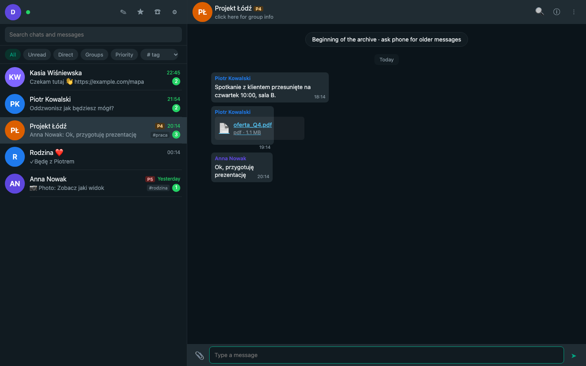

<div align="center">

# wamcp

**Your WhatsApp, archived on your own machine, readable by your AI agents.**

[](LICENSE)
[](https://go.dev)
[](#mcp-tools)
[](#install)

</div>



<sub>The web client running on synthetic data (`make demo`). Names and numbers are made up.</sub>

<div align="center">

### What you get

</div>

| | |
|---|---|
| **A real WhatsApp client** | Links as a device, like WhatsApp Web or Desktop. Read, search, send, reply, react, edit, delete, files, archive, pin, mute, calls, starred, group info. |
| **A complete local archive** | Every message, group, contact and call goes into SQLite with full-text search. Nothing leaves your machine. |
| **An MCP server** | 13 tools for Claude Code, Claude Desktop and any MCP client: "what did I miss", search across all chats, people, groups, calls. |
| **Your own notes on people** | Alias, description, priority 1 to 5, tags and custom fields on any contact or chat. Agents can filter by them. |
| **Nothing lost on restart** | Messages are acked to WhatsApp only after they are written to disk. Offline gaps are recovered and counted. |
| **One static binary** | Pure Go, no cgo, no Docker, no database server. A macOS LaunchAgent in one command. |

## Why wamcp

I wanted my agents to know what is going on in my WhatsApp: who wrote, what they asked, what I promised. The options were bad. Cloud bridges push your private chats through someone else's server. Scrapers break every month. Exporting chats by hand is a joke.

So wamcp runs on your machine as a linked device, keeps the whole archive locally, and lets an agent read it over MCP. The MCP side is **read-only**: it never sends anything to WhatsApp. If an agent should answer someone, it drafts the text and you send it.

## Table of contents

- [Quick start](#quick-start)
- [Install](#install)
- [Run it in the background](#run-it-in-the-background)
- [Connect an AI assistant](#connect-an-ai-assistant)
- [MCP tools](#mcp-tools)
- [Contact notes](#contact-notes)
- [Reliability](#reliability)
- [Data and security](#data-and-security)
- [Limitations](#limitations)
- [CLI](#cli)
- [Development](#development)
- [License](#license)

## Quick start

```sh
git clone https://github.com/mi4uu/wamcp && cd wamcp
make install      # builds and installs ~/.local/bin/wamcp
wamcp serve       # first run prints a sign-in link and a QR code
```

Open the printed link (or run `wamcp open`). On your phone go to **WhatsApp > Settings > Linked devices > Link a device** and scan the QR code. You can link with a pair code instead: `wamcp serve --pair-phone +48600000000`.

After linking, the phone uploads your history in batches. Keep WhatsApp open on the phone for a few minutes. Progress shows in the web client settings, in `wamcp status` and in the `whatsapp_status` MCP tool.

## Install

### From source

Needs Go 1.26 or newer.

```sh
go install github.com/mi4uu/wamcp/cmd/wamcp@latest
```

or clone and `make install` as above (installs to `~/.local/bin`, set `PREFIX` to change it).

macOS and Linux both work. The background service (`wamcp service`) is macOS only for now. On Linux, run `wamcp serve` under systemd.

## Run it in the background

macOS LaunchAgent: starts at login, restarts after crashes.

```sh
wamcp service install     # add --auto-media to download media of new messages
wamcp service status
wamcp service uninstall   # the archive is kept
```

Logs: `~/.wamcp/logs/wamcp.log`.

## Connect an AI assistant

`wamcp config` prints ready-to-paste snippets with your token.

**Claude Code** over HTTP (the daemon must be running; includes media download):

```sh
claude mcp add --transport http --scope user whatsapp http://127.0.0.1:8765/mcp \
  --header "Authorization: Bearer $(wamcp token)"
```

**Claude Desktop** and other stdio clients read the archive directly, even when the daemon is stopped:

```json
{ "mcpServers": { "whatsapp": { "command": "/Users/you/.local/bin/wamcp", "args": ["mcp"] } } }
```

## MCP tools

| Tool | What it does |
|---|---|
| `whatsapp_status` | Connection, history sync and catch-up progress, archive totals |
| `list_chats` | Chats with activity, unread counts, your priority and tags; filters and sorting |
| `get_chat` | Chat details, your notes, statistics, group description and members |
| `get_messages` | Messages of one chat; time ranges, paging, sender, media and starred filters |
| `get_recent_messages` | Everything in a time window across chats ("what did I miss") |
| `search_messages` | Full-text search, accent-insensitive ("lodz" finds "Łódź"), phrases |
| `get_message_context` | Messages around a hit |
| `search_contacts` / `get_contact` | People, the names WhatsApp knows, your notes, shared groups |
| `list_groups` | Groups and communities, membership |
| `list_calls` | Call history |
| `update_contact_meta` | Edit your private notes (local only, never sent to WhatsApp) |
| `download_media` | Save an attachment locally (HTTP mode) |
| `request_older_messages` | Ask the phone for older history of a chat (HTTP mode) |

Chats and people can be given as a JID, a phone number or part of a name.

## Contact notes

Every contact, group or chat can carry private notes: **alias** (display name override), **description**, **priority** 1 to 5 (lowest, low, normal, high, top), **tags** and **custom fields** (for example `birthday: 14.03`). Edit them in the web client (chat info panel) or with `update_contact_meta`.

The MCP tools show the notes next to contacts and chats and can filter by them:

```text
list_chats min_priority=4
get_recent_messages min_priority=4
search_contacts tag=family
```

## Reliability

- Messages are acknowledged to WhatsApp only **after** they are committed to the archive, and decrypted payloads are buffered until then. If the process crashes, the server delivers the message again.
- While the daemon is stopped (laptop asleep, restart, network down), WhatsApp queues messages for the linked device and delivers them on reconnect. wamcp records how long it was offline and how many messages it recovered (`whatsapp_status`, web settings).
- If the phone unlinks the device, for example after a very long break, the web client shows the QR code again. Relinking triggers a full history sync that fills the gap. Messages are de-duplicated by ID.
- Hidden-number identities (`@lid`) are mapped to phone numbers as soon as WhatsApp reveals the mapping, and older rows are merged.

## Data and security

Everything lives in `~/.wamcp` (mode `0700`):

| Path | What |
|---|---|
| `archive.db` | The archive: SQLite with FTS5 |
| `whatsmeow.db` | Session keys of the linked device |
| `media/`, `avatars/` | Downloaded attachments and profile pictures |
| `token` | Access token for MCP and the web client |

- The server listens on `127.0.0.1` only. `/mcp` requires `Authorization: Bearer <token>`. The web client needs a session cookie obtained with the token (`wamcp open`). Requests with a foreign `Host` header (DNS rebinding) and cross-site form posts are rejected.
- Messages deleted for everyone keep their content in the archive and are marked with who deleted them and when. They stay searchable. Run `wamcp serve --deleted remove` to wipe them instead, like WhatsApp does.
- The daemon does not mark you "online" in the background, so your phone keeps its notifications. The web client shows you online only while its tab is visible.

## Limitations

- wamcp uses the unofficial multi-device protocol. WhatsApp's terms do not allow unofficial clients. The risk of account restrictions is low for read-mostly personal use, but it is not zero.
- History depth depends on what the phone sends. Older messages can be requested per chat while the phone is online.
- Media links expire after some weeks. wamcp then asks the phone to re-upload, which works only if the phone still has the file.
- Not archived yet: poll votes, channel (newsletter) posts, status view lists. Voice recording in the browser is not supported (audio files can be sent).

## CLI

```text
wamcp serve     Run the daemon: link and sync WhatsApp, web client, MCP over HTTP
wamcp mcp       Serve MCP over stdio (reads the archive)
wamcp open      Open the web client in the browser, signed in
wamcp config    Print MCP client configuration
wamcp token     Print the access token
wamcp status    Show daemon, sync and archive status
wamcp service   install | uninstall | restart | status (macOS)
wamcp logout    Unlink this device from WhatsApp (daemon must be stopped)
wamcp version
```

Common flags: `--data-dir` (default `~/.wamcp`, env `WAMCP_DATA_DIR`) and `--listen` (default `127.0.0.1:8765`, env `WAMCP_LISTEN`). Run `wamcp <command> -h` for the rest.

## Development

```sh
make test    # unit tests: archive, ingestion, MCP tools, HTTP auth
make demo    # web client with synthetic data on 127.0.0.1:8799
make build
```

| Package | What |
|---|---|
| `internal/archive` | SQLite schema, queries, names |
| `internal/ingest` | WhatsApp events into the archive |
| `internal/wa` | Connection, pairing, catch-up, media, sending |
| `internal/mcpserver` | MCP tools |
| `internal/web` | HTTP API and the embedded web client |
| `internal/service` | launchd integration |
| `cmd/wamcp` | The CLI |

## License

[AGPL-3.0-or-later](LICENSE).

Built on [whatsmeow](https://github.com/tulir/whatsmeow) (MPL-2.0), the multi-device WhatsApp Web protocol library behind the mautrix bridge, and the official [MCP Go SDK](https://github.com/modelcontextprotocol/go-sdk). Not affiliated with WhatsApp or Meta.
