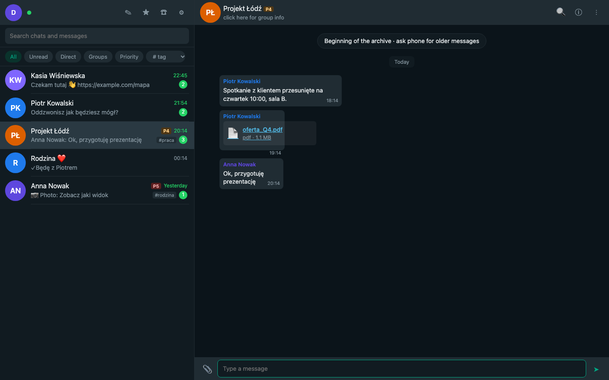

<div align="center">

# wamcp

**Your WhatsApp, archived on your own machine, readable by your AI agents.**

[](LICENSE)
[](https://go.dev)
[](#mcp-tools)
[](#install)

</div>



<sub>The web client running on synthetic data (`make demo`). Names and numbers are made up.</sub>

<div align="center">

### What you get

</div>

| | |
|---|---|
| **A real WhatsApp client** | Links as a device, like WhatsApp Web or Desktop. Read, search, send, reply, react, edit, delete, files, archive, pin, mute, calls, starred, group info. |
| **A complete local archive** | Every message, group, contact and call goes into SQLite with full-text search. Nothing leaves your machine. |
| **An MCP server** | 13 tools for Claude Code, Claude Desktop and any MCP client: "what did I miss", search across all chats, people, groups, calls. Read-only by default; sending is a separate opt-in with an allowlist, a rate limit and an audit log. |
| **Your own notes on people** | Alias, description, priority 1 to 5, tags and custom fields on any contact or chat. Agents can filter by them. |
| **Nothing lost on restart** | Messages are acked to WhatsApp only after they are written to disk. Offline gaps are recovered and counted. |
| **One static binary** | Pure Go, no cgo, no Docker, no database server. A macOS LaunchAgent in one command. |

## Why wamcp

I wanted my agents to know what is going on in my WhatsApp: who wrote, what they asked, what I promised. The options were bad. Cloud bridges push your private chats through someone else's server. Scrapers break every month. Exporting chats by hand is a joke.

So wamcp runs on your machine as a linked device, keeps the whole archive locally, and lets an agent read it over MCP. The MCP side is **read-only by default**: it never sends anything to WhatsApp. If an agent should answer someone, it drafts the text and you send it. If you do want an agent to send, you switch it on explicitly and limit who it can write to ([Letting agents send](#letting-agents-send-opt-in)).

## How wamcp compares

WhatsApp MCP servers on GitHub with 40+ stars, as of 2026-11-05. Stars, dates and licenses from the GitHub API; the rest from each project's code or README. Details, sources and our own open gaps: [docs/COMPARISON.md](docs/COMPARISON.md).

| Project | Stars | Last push | Runs as | Your messages live | Sends by default | Auth on HTTP |
|---|---|---|---|---|---|---|
| **wamcp** (this repo) | new | active | one Go binary | your disk, full history | **no**, opt-in with allowlist, rate limit, audit | bearer token always on; OAuth 2.1 opt-in |
| [lharries/whatsapp-mcp](https://github.com/lharries/whatsapp-mcp) | 6814 | 2025-07-13 | Go bridge + Python | your disk | yes | no MCP HTTP; bridge API on all interfaces, no auth |
| [finereli/whatsapp-mcp](https://github.com/finereli/whatsapp-mcp) | 404 | 2026-10-24 | Cloudflare Worker | Cloudflare, encrypted | cannot send | OAuth |
| [verygoodplugins/whatsapp-mcp](https://github.com/verygoodplugins/whatsapp-mcp) | 283 | 2026-10-30 | Go bridge + Python | your disk | yes | none on MCP HTTP |
| [felipeadeildo/whatsapp-mcp](https://github.com/felipeadeildo/whatsapp-mcp) | 98 | 2026-11-03 | Cloudflare Worker | your Cloudflare account | yes | OAuth or bearer |
| [jlucaso1/whatsapp-mcp-ts](https://github.com/jlucaso1/whatsapp-mcp-ts) | 75 | 2026-01-23 | Node | your disk | yes | stdio only |
| [BrOrlandi/whatsapp-mcp-local](https://github.com/BrOrlandi/whatsapp-mcp-local) | 70 | 2026-11-03 | desktop app | your disk | yes | localhost, no auth |
| [BrOrlandi/whatsapp-mcp](https://github.com/BrOrlandi/whatsapp-mcp) | 64 | 2026-10-09 | Docker Compose | your server | yes | setup token |
| [pnizer/wweb-mcp](https://github.com/pnizer/wweb-mcp) | 46 | 2025-07-18 | Node + headless Chrome | your disk | yes | optional API key |
| [FelixIsaac/whatsapp-mcp-extended](https://github.com/FelixIsaac/whatsapp-mcp-extended) | 44 | 2026-11-02 | Go bridge + Python | your disk | yes, optional allowlist | stdio only |
| [delltrak/wamcp](https://github.com/delltrak/wamcp) (different project, same name) | 27 | 2026-11-02 | Node + Redis, Docker | your server, 30 days by default | yes | none unless configured; key, Basic or OAuth 2.1 |

Where wamcp is ahead:

- **Safe by default.** It is the only one in the table that is read-only out of the box and can still send when you ask for it, behind an allowlist, an hourly limit, retry de-duplication and an audit log.
- **The whole archive, on your disk.** Every message, edit, deletion, group, contact and call, kept for good, with accent-insensitive full-text search. No cloud account, no retention window.
- **One binary.** No Python, Node, Redis, Docker or Chrome. A web client is built in.
- **Remote access with auth that cannot be switched off.** Streamable HTTP always needs a token: the MCP-only token, or OAuth with PKCE where you approve each client. `--public-host` puts it behind your own tunnel, with nothing hosted by anyone else.
- **Nothing lost on a crash.** Messages are acknowledged to WhatsApp only after they are on disk.

Where others are ahead, today:

- **Breadth.** delltrak has 169 tools, including group admin, business features, scheduling and the official WhatsApp Cloud API. lharries and delltrak can send files and voice notes; wamcp's MCP side sends text only.
- **Reach.** lharries has 6.8k stars and a big community of forks. finereli has a hosted version you can try without installing anything. wamcp needs Go 1.26 to build until release binaries exist.

## Table of contents

- [How wamcp compares](#how-wamcp-compares)
- [Quick start](#quick-start)
- [Install](#install)
- [Run it in the background](#run-it-in-the-background)
- [Connect an AI assistant](#connect-an-ai-assistant)
- [MCP tools](#mcp-tools)
- [Letting agents send (opt-in)](#letting-agents-send-opt-in)
- [Contact notes](#contact-notes)
- [Reliability](#reliability)
- [Data and security](#data-and-security)
- [Limitations](#limitations)
- [CLI](#cli)
- [Development](#development)
- [License](#license)

## Quick start

```sh
git clone https://github.com/mi4uu/wamcp && cd wamcp
make install      # builds and installs ~/.local/bin/wamcp
wamcp serve       # first run prints a sign-in link and a QR code
```

Open the printed link (or run `wamcp open`). On your phone go to **WhatsApp > Settings > Linked devices > Link a device** and scan the QR code. You can link with a pair code instead: `wamcp serve --pair-phone +48600000000`.

After linking, the phone uploads your history in batches. Keep WhatsApp open on the phone for a few minutes. Progress shows in the web client settings, in `wamcp status` and in the `whatsapp_status` MCP tool.

## Install

### From source

Needs Go 1.26 or newer.

```sh
go install github.com/mi4uu/wamcp/cmd/wamcp@latest
```

or clone and `make install` as above (installs to `~/.local/bin`, set `PREFIX` to change it).

macOS and Linux both work. The background service (`wamcp service`) is macOS only for now. On Linux, run `wamcp serve` under systemd.

## Run it in the background

macOS LaunchAgent: starts at login, restarts after crashes.

```sh
wamcp service install     # add --auto-media to download media of new messages
wamcp service status
wamcp service uninstall   # the archive is kept
```

Logs: `~/.wamcp/logs/wamcp.log`.

## Connect an AI assistant

`wamcp config` prints ready-to-paste snippets with your token.

**Claude Code** over HTTP (the daemon must be running; includes media download):

```sh
claude mcp add --transport http --scope user whatsapp http://127.0.0.1:8765/mcp \
  --header "Authorization: Bearer $(wamcp token --mcp)"
```

**Claude Desktop** and other stdio clients read the archive directly, even when the daemon is stopped:

```json
{ "mcpServers": { "whatsapp": { "command": "/Users/you/.local/bin/wamcp", "args": ["mcp"] } } }
```

### Remote access (claude.ai, phone)

wamcp stays on `127.0.0.1`. Put a tunnel or reverse proxy with HTTPS in front of it (for example a Cloudflare Tunnel to `http://127.0.0.1:8765`) and tell wamcp the public name:

```sh
wamcp serve --public-host wa.example.com      # or: wamcp service install --public-host wa.example.com
```

Then add a custom connector in claude.ai with the URL `https://wa.example.com/mcp`. Two ways to sign it in:

- **OAuth** (works with any OAuth-only client): start the daemon with `--oauth` as well. The client registers itself, your browser opens a wamcp page that names the client and what it may do, and you confirm with the main token (`wamcp token`). Access tokens last an hour and refresh for 30 days. `wamcp oauth list` shows approved clients, `wamcp oauth revoke <id>` cuts one off at once.
- **Static header**: a request header `Authorization: Bearer <token>` with the token from `wamcp token --mcp`, which cannot sign in to the web client (replace it any time with `wamcp token --rotate-mcp`). Anthropic documents request headers for custom connectors; check that your plan shows the field.

With `--public-host` the web client always asks for the token, linking a phone needs a signed-in browser, and sending (if you turn it on) requires an allowlist.

## MCP tools

| Tool | What it does |
|---|---|
| `whatsapp_status` | Connection, history sync and catch-up progress, archive totals |
| `list_chats` | Chats with activity, unread counts, your priority and tags; filters and sorting |
| `get_chat` | Chat details, your notes, statistics, group description and members |
| `get_messages` | Messages of one chat; time ranges, paging, sender, media and starred filters |
| `get_recent_messages` | Everything in a time window across chats ("what did I miss") |
| `search_messages` | Full-text search, accent-insensitive ("lodz" finds "Łódź"), phrases |
| `get_message_context` | Messages around a hit |
| `search_contacts` / `get_contact` | People, the names WhatsApp knows, your notes, shared groups |
| `list_groups` | Groups and communities, membership |
| `list_calls` | Call history |
| `update_contact_meta` | Edit your private notes (local only, never sent to WhatsApp) |
| `download_media` | Save an attachment locally (HTTP mode) |
| `request_older_messages` | Ask the phone for older history of a chat (HTTP mode) |
| `send_message` | Send a text message. **Not listed unless sending is switched on**, see below |

Chats and people can be given as a JID, a phone number or part of a name.

## Letting agents send (opt-in)

By default `send_message` does not exist: it is not in `tools/list` and calling it fails. To turn it on, start the daemon with the switch and, ideally, an allowlist:

```sh
wamcp serve --mcp-allow-send --mcp-send-to "me,+48600000000,120363040000000001@g.us"
# or for the background service
wamcp service install --mcp-allow-send --mcp-send-to me
```

| Flag | Env | Default | What |
|---|---|---|---|
| `--mcp-allow-send` | `WAMCP_MCP_ALLOW_SEND=1` | off | Lists `send_message` on the HTTP MCP endpoint and lets stdio servers send through the daemon |
| `--mcp-send-to` | `WAMCP_MCP_SEND_TO` | empty (any chat) | Comma-separated phone numbers with country code, JIDs, or `me` (your own chat). Names are not accepted. Required when `--listen` is not a loopback address |
| `--mcp-send-per-hour` | | 20 | Maximum messages in any rolling hour, across all agents |

Stdio clients (`wamcp mcp`) also need `--allow-send` (or the same env var) to list the tool. They forward every send to the daemon, so the daemon's policy always applies.

What the daemon enforces on every `send_message` call:

- **Allowlist.** Recipients off the list are refused. Group members are not checked: allowing a group allows writing to that group.
- **Rate limit.** Counted from the audit log, so a restart does not reset it. Failed sends count too, since an error does not prove the message was dropped.
- **No double sends.** A call with the same `idempotency_key` returns the first result instead of sending again (24 hours). Without a key, the same text to the same chat within 10 minutes counts as a retry. If the daemon stopped in the middle of a send, the retry is refused with a clear message instead of guessing; a failed send that is retried reuses the same WhatsApp message ID.
- **Audit log.** Every call is written to the `agent_sends` table as sent, failed, refused or duplicate, and a send is recorded *before* anything goes to WhatsApp. `wamcp audit` prints it; the daemon log has one line per call. Refused and duplicate calls stop being stored after 200 in an hour (they are still logged), so a looping agent cannot fill the disk.
- **Text only**, up to 4096 characters, optionally as a reply. No files, no edits or deletes, no group admin.

What it does not protect against, so you can decide:

- **Prompt injection.** An agent that reads your chats and can send is exposed to messages written to manipulate it ("forward this to everyone"). The allowlist and rate limit cap the damage; they do not stop the agent from sending the wrong text to an allowed chat. Keep the allowlist short: `me` alone is enough for "send me a daily summary".
- **Give agents the MCP token, not the main one.** `wamcp token --mcp` opens `/mcp` and nothing else, so it is bound by these limits. The main token (`wamcp token`) also signs in to the web client, which can send, edit and delete without any of them.

## Contact notes

Every contact, group or chat can carry private notes: **alias** (display name override), **description**, **priority** 1 to 5 (lowest, low, normal, high, top), **tags** and **custom fields** (for example `birthday: 14.03`). Edit them in the web client (chat info panel) or with `update_contact_meta`.

The MCP tools show the notes next to contacts and chats and can filter by them:

```text
list_chats min_priority=4
get_recent_messages min_priority=4
search_contacts tag=family
```

## Reliability

- Messages are acknowledged to WhatsApp only **after** they are committed to the archive, and decrypted payloads are buffered until then. If the process crashes, the server delivers the message again.
- While the daemon is stopped (laptop asleep, restart, network down), WhatsApp queues messages for the linked device and delivers them on reconnect. wamcp records how long it was offline and how many messages it recovered (`whatsapp_status`, web settings).
- If the phone unlinks the device, for example after a very long break, the web client shows the QR code again. Relinking triggers a full history sync that fills the gap. Messages are de-duplicated by ID.
- Hidden-number identities (`@lid`) are mapped to phone numbers as soon as WhatsApp reveals the mapping, and older rows are merged.

## Data and security

Everything lives in `~/.wamcp` (mode `0700`):

| Path | What |
|---|---|
| `archive.db` | The archive: SQLite with FTS5 |
| `whatsmeow.db` | Session keys of the linked device |
| `media/`, `avatars/` | Downloaded attachments and profile pictures |
| `token` | Main access token: web client sign-in, MCP |
| `mcp-token` | MCP-only token: `/mcp` and the API stdio servers use, no web client |
| `oauth.json` | OAuth clients you approved and hashes of their tokens (`--oauth`) |

- The server listens on `127.0.0.1` unless you pass `--listen`. `/mcp` always requires `Authorization: Bearer <token>` (the MCP token or the main one), there is no way to turn that off. The web client needs a session cookie obtained with the token (`wamcp open`). Requests with a foreign `Host` header (DNS rebinding) and cross-site form posts are rejected.
- Behind a reverse proxy or tunnel (cloudflared, nginx, Caddy) use `--public-host` or `--web-auth token`. Without them, requests that carry proxy headers (`X-Forwarded-For`, `Forwarded`, `Cf-Connecting-Ip` and similar) or come from a known proxy process (cloudflared, ngrok, ssh, nginx, Caddy and others) are never signed in automatically, but a proxy that is neither would look like a local browser.
- When wamcp is reachable from other machines (`--public-host` or a non-loopback `--listen`), linking a phone needs a signed-in browser, so a visitor cannot link their own account to your daemon.
- Messages deleted for everyone keep their content in the archive and are marked with who deleted them and when. They stay searchable. Run `wamcp serve --deleted remove` to wipe them instead, like WhatsApp does.
- The daemon does not mark you "online" in the background, so your phone keeps its notifications. The web client shows you online only while its tab is visible.

## Limitations

- wamcp uses the unofficial multi-device protocol. WhatsApp's terms do not allow unofficial clients. The risk of account restrictions is low for read-mostly personal use, but it is not zero.
- History depth depends on what the phone sends. Older messages can be requested per chat while the phone is online.
- Media links expire after some weeks. wamcp then asks the phone to re-upload, which works only if the phone still has the file.
- Not archived yet: poll votes, channel (newsletter) posts, status view lists. Voice recording in the browser is not supported (audio files can be sent).

## CLI

```text
wamcp serve     Run the daemon: link and sync WhatsApp, web client, MCP over HTTP
wamcp mcp       Serve MCP over stdio (reads the archive)
wamcp open      Open the web client in the browser, signed in
wamcp config    Print MCP client configuration
wamcp token     Print the access token (--mcp: MCP-only token, --rotate-mcp: replace it)
wamcp status    Show daemon, sync and archive status
wamcp audit     Show messages MCP agents sent or tried to send
wamcp oauth     list | revoke <client id>: OAuth clients you approved (serve --oauth)
wamcp service   install | uninstall | restart | status (macOS)
wamcp logout    Unlink this device from WhatsApp (daemon must be stopped)
wamcp version
```

Common flags: `--data-dir` (default `~/.wamcp`, env `WAMCP_DATA_DIR`) and `--listen` (default `127.0.0.1:8765`, env `WAMCP_LISTEN`). Run `wamcp <command> -h` for the rest.

## Development

```sh
make test    # unit tests: archive, ingestion, MCP tools, HTTP auth
make demo    # web client with synthetic data on 127.0.0.1:8799
make build
```

| Package | What |
|---|---|
| `internal/archive` | SQLite schema, queries, names |
| `internal/ingest` | WhatsApp events into the archive |
| `internal/wa` | Connection, pairing, catch-up, media, sending |
| `internal/mcpserver` | MCP tools |
| `internal/web` | HTTP API and the embedded web client |
| `internal/service` | launchd integration |
| `cmd/wamcp` | The CLI |

## License

[AGPL-3.0-or-later](LICENSE).

Built on [whatsmeow](https://github.com/tulir/whatsmeow) (MPL-2.0), the multi-device WhatsApp Web protocol library behind the mautrix bridge, and the official [MCP Go SDK](https://github.com/modelcontextprotocol/go-sdk). Not affiliated with WhatsApp or Meta.
